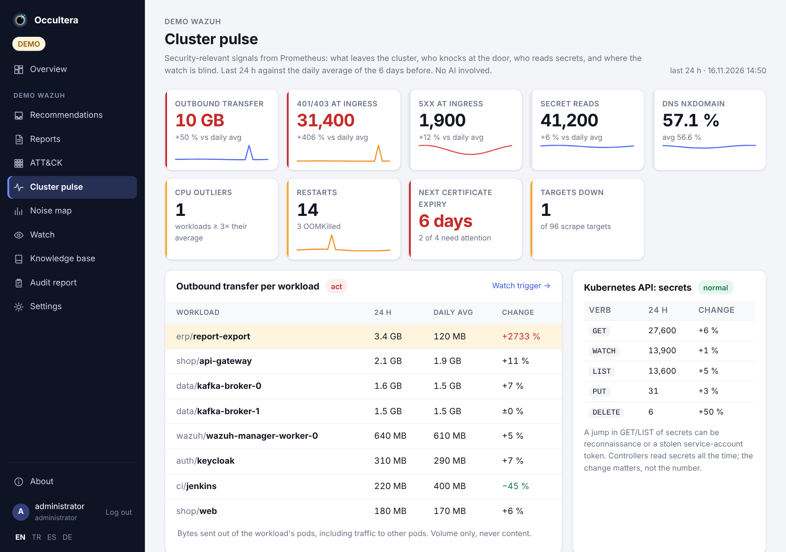

# Küme nabzı

[English](Cluster-Pulse) · **Türkçe**

Ortamın Prometheus'undan okunan, güvenlik açısından anlamlı sinyaller sayfası: kümeden ne çıkıyor, kapıyı kim
çalıyor, secret'ları kim okuyor ve nöbet nerede kör. Son 24 saati, önceki altı günün günlük ortalamasıyla
karşılaştırır (pencere 7 günlük saklama süresinin içinde kalır). Yapay zekâ kullanılmaz; her sayı kendiniz
çalıştırabileceğiniz bir PromQL sorgusudur.

Menü girişi yalnız `sources.prometheus` tanımlı ortamlarda görünür (bkz. [Yapılandırma](Configuration-TR)). Sayfa
bir dakika önbellekte tutulur.

## Paneller

| Panel | Metrik | Neden önemli | İşaret |
|---|---|---|---|
| Dışarı aktarım | cAdvisor `container_network_transmit_bytes_total`, namespace ve iş yükü başına | bir veri sızıntısı çoğunlukla hacimdir; [nöbet tetikleyicisiyle](Watch-TR#olağan-dışı-dışarı-aktarım) aynı veri | günlük ortalamanın ≥ 3 katı (bak) ya da ≥ 10 katı (müdahale), 1 GB üstü |
| Giriş | `kong_http_requests_total`, `traefik_router_requests_total`, `traefik_service_requests_total` ya da `nginx_ingress_controller_requests`, hangisi varsa | bir rotada çok 401/403: parola deneme ya da tarama; 404/405: yol yoklama; 5xx: cevap vermeyen arka uç | 401/403 ya da 5xx ortalamanın ≥ 3 / 10 katı, 500 üstü |
| Kubernetes API: secret'lar | `apiserver_request_total{resource="secrets"}` | GET/LIST'te sıçrama keşif ya da çalınmış bir service-account token'ıdır | okumalar ortalamanın ≥ 3 / 10 katı, 1.000 üstü |
| DNS | `coredns_dns_responses_total` | hacim ve NXDOMAIN oranının ortalamaya göre değişimi: tünelleme ya da DGA zararlısı | hacim ≥ 3 kat, NXDOMAIN oranı +15 puan, SERVFAIL |
| Kendi ortalamasına göre CPU | `container_cpu_usage_seconds_total`, son saat ve 6 günlük ortalama | olağanın çok üstünde süren CPU, kripto madencinin klasik izidir | ortalamanın ≥ 3 katı, 0,25 çekirdek üstü |
| Yeniden başlatmalar | `kube_pod_container_status_restarts_total`, `kube_pod_container_status_last_terminated_reason` | bir istismar denemesi ya da kaynak saldırısı sonrası crash loop ve OOM | ortalamanın ≥ 3 katı ya da bir iş yükünde 10+ |
| Sertifikalar | `certmanager_certificate_expiration_timestamp_seconds`, `certmanager_certificate_ready_status` | süresi dolan sertifika hizmeti durdurur; Let's Encrypt'te 30 günden az kaldıysa yenileme takılmıştır | < 21 gün (bak), < 7 gün ya da hazır değil (müdahale) |
| İzlemenin kör noktaları | `up == 0` | düşük bir hedef metrik göndermez: yukarıdaki paneller onu göremez | düşük herhangi bir hedef |

İş yükü panelleri, küme altyapısı namespace'lerini nöbetin dışarı aktarım tetikleyicisiyle aynı listeyle dışarıda
bırakır (Ayarlar → Nöbet → *Bu namespace'leri sayma*). Kümede metriği olmayan panel bunu söyler; hata veren bir
sorgu yalnız kendi panelini gizler.

## Nasıl okunur

Sayılar hacmi ve değişimi anlatır, içeriği asla. Kırmızı bir kart bakmak için bir nedendir, hüküm değil: iş yükünün
loglarını açın (Loki, `kubectl logs`), neyin değiştiğine bakın (deployment, job, yedek) ve aynı saatlerin Wazuh
alarmlarını inceleyin. Doğrulanan bir durumu her bulgu gibi [nöbetten](Watch-TR) ya da rapordan kaydedin.

---

*0.12.2 için geçerli · 2026-11-16'da gözden geçirildi*

---

[English](Cluster-Pulse) · [Türkçe](Cluster-Pulse-TR)
