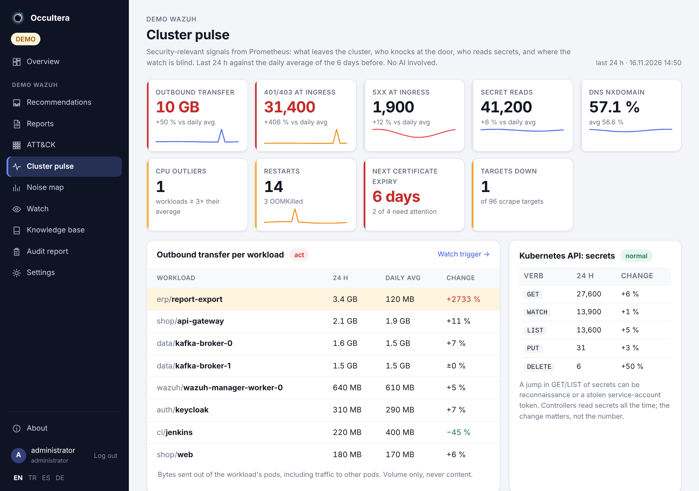

# Cluster pulse

**English** · [Türkçe](Cluster-Pulse-TR)

A page of security-relevant signals read from the environment's Prometheus: what leaves the cluster, who knocks
at the door, who reads secrets, and where the watch is blind. It shows the last 24 hours against the daily average
of the six days before (the window stays inside a 7-day retention). No AI is involved; every number is a PromQL
query you can run yourself.

The menu entry appears only for environments with a `sources.prometheus` entry (see [Configuration](Configuration)).
The page is cached for one minute.

## Panels

| Panel | Metric | Why it matters | Flag |
|---|---|---|---|
| Outbound transfer | cAdvisor `container_network_transmit_bytes_total`, per namespace and workload | a data leak is mostly volume; the same data as the [watch trigger](Watch#unusual-outbound-transfer) | ≥ 3× (look) or ≥ 10× (act) the daily average, above 1 GB |
| Ingress | `kong_http_requests_total`, `traefik_router_requests_total`, `traefik_service_requests_total` or `nginx_ingress_controller_requests`, whichever exists | many 401/403 on one route: credential stuffing or scanning; 404/405: path probing; 5xx: a backend that does not answer | 401/403 or 5xx ≥ 3× / 10× the average, above 500 |
| Kubernetes API: secrets | `apiserver_request_total{resource="secrets"}` | a jump in GET/LIST is reconnaissance or a stolen service-account token | reads ≥ 3× / 10× the average, above 1,000 |
| DNS | `coredns_dns_responses_total` | volume and NXDOMAIN share against the average: tunnelling or DGA malware | volume ≥ 3×, NXDOMAIN share +15 points, SERVFAIL |
| CPU against its own average | `container_cpu_usage_seconds_total`, last hour against the 6-day average | sustained CPU far above normal is the classic crypto-miner sign | ≥ 3× its average, above 0.25 cores |
| Restarts | `kube_pod_container_status_restarts_total`, `kube_pod_container_status_last_terminated_reason` | crash loops and OOM kills after an exploit attempt or a resource attack | ≥ 3× the average, or 10+ in one workload |
| Certificates | `certmanager_certificate_expiration_timestamp_seconds`, `certmanager_certificate_ready_status` | an expired certificate breaks the service; fewer than 30 days on Let's Encrypt means the renewal is stuck | < 21 days (look), < 7 days or not ready (act) |
| Monitoring blind spots | `up == 0` | a target that is down sends no metrics: the panels above cannot see it | any target down |

Plumbing namespaces are left out of the per-workload panels with the same list as the watch's outbound-transfer
trigger (Settings → Watch → *Leave out these namespaces*). A panel whose metrics do not exist in the cluster says
so; a failing query hides only its own panel.

## Reading it

The numbers describe volume and change, never content. A red tile is a reason to look, not a verdict: open the
workload's logs (Loki, `kubectl logs`), check what changed (deployments, jobs, backups) and look at the Wazuh alerts
of the same hours. For a confirmed case, file it from the [watch](Watch) or the report like any other finding.

---

*Applies to 0.12.2 · reviewed 2026-11-16*

---

[English](Cluster-Pulse) · [Türkçe](Cluster-Pulse-TR)
