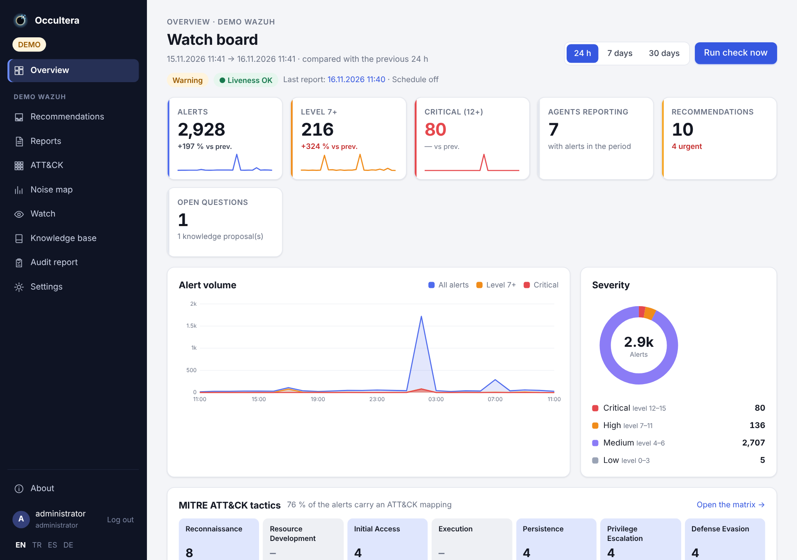

# Occultera — Wiki

[English](Home) · [Türkçe](Home-TR) · [Español](Home-ES) · [Français](Home-FR) · **Deutsch**

**Open-Source-MCP-Server und KI-Alarmtriage für Wazuh 4.x** (Unterstützung für Wazuh 5.x in Entwicklung), mit
personenbezogenen Daten, die vor der KI maskiert werden (DSGVO). Ein Bereitschaftsbegleiter: Er beobachtet Ihre
Alarme rund um die Uhr und meldet sich binnen Minuten, wenn etwas dringend ist — ohne eine KI zu fragen. Ein- oder
zweimal täglich prüft eine KI-Runde alles, was die Wache gesehen hat, erklärt es und schlägt Anpassungen vor. Sie
entscheiden; ohne Ihre Freigabe ändert sich nichts in Wazuh.

> **Erkannte personenbezogene Daten werden vor der KI maskiert.** E-Mail-Adressen, Telefonnummern, nationale
> Kennungen, IBAN, Kartennummern, Passwörter, Tokens und Schlüssel werden durch Pseudonyme wie `<email:3f9a…>`
> ersetzt, **bevor** etwas an das Modell geht — standardmäßig aktiv. Geheimnisse lassen sich gar nicht zurückwandeln.
> Ihre Berichte behalten die echten Werte, innerhalb Ihrer Installation. → [Privacy](Privacy)

> **Fragen Sie Ihr Wazuh aus jedem MCP-fähigen Agenten.** Der eingebaute MCP-Server gibt Claude Desktop, Claude Code,
> Cursor, VS Code und anderen dieselben lesenden Werkzeuge wie der KI — Alarmsuche, Zeitverläufe, IP-Profile, Agenten,
> Regelinfos, logtest, Berichte — mit denselben Grenzen und derselben Maskierung. → [MCP-Server](MCP)

**Aktuelle Version:** 0.18.0 · **Lizenz:** AGPL-3.0-only · **Wazuh:** 4.x · 5.x kommt mit 1.0 ([Wazuh 5](Wazuh-5))

## Was es ist, und was nicht

| Es ist | Es ist nicht |
|---|---|
| eine tägliche Prüfung und Bereitschaftshilfe, die liest, was Wazuh erzeugt hat | ein Ersatz für Wazuh oder sein Dashboard |
| gegenüber Wazuh standardmäßig nur lesend | ein SOAR: es blockiert, isoliert und führt nichts auf Agenten aus |
| Regelentwürfe, die Sie prüfen und freigeben | eine DLP-Lösung oder eine Konformitätserklärung |

## Wo anfangen

| Ich möchte … | Seite (auf Englisch) |
|---|---|
| es in fünf Minuten mit Demodaten ausprobieren | [Getting started](Getting-Started) |
| es mit Docker Compose oder Kubernetes installieren | [Installation](Installation) · [Kubernetes](Kubernetes) |
| verstehen, was die KI sieht und was nicht | [Privacy](Privacy) · [Security model](Security-Model) |
| Claude Desktop oder Cursor anbinden | [MCP server](MCP) |
| dringende Alarme ohne KI erhalten | [Watch](Watch) |
| wissen, was als Nächstes kommt | [Roadmap](Roadmap) · [Wazuh 5](Wazuh-5) |

Die Oberfläche gibt es auf Deutsch; die ausführliche Dokumentation ist auf Englisch und Türkisch.
